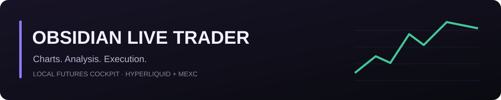
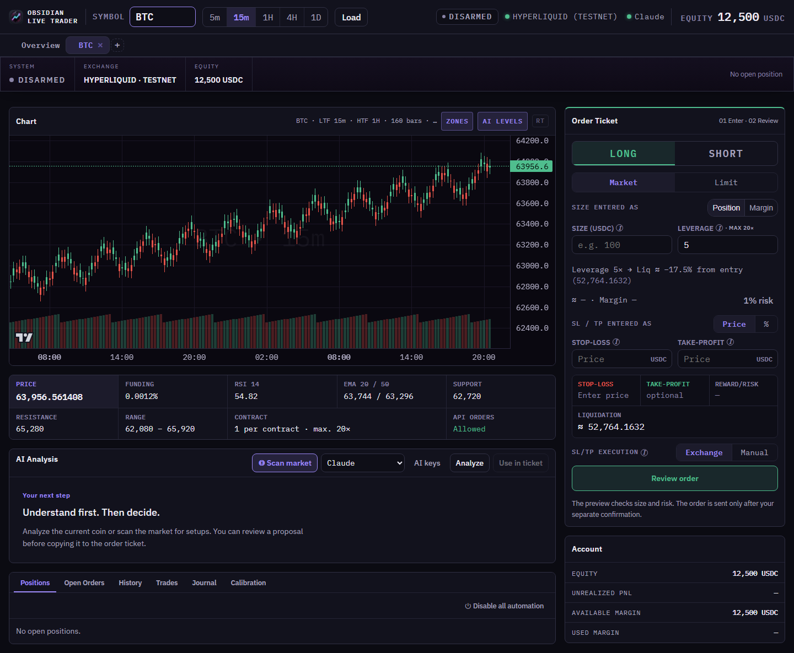

<p align="center">
  
</p>

# Obsidian Live Trader

[](https://github.com/Chap0815/ObsidianLiveTrader/actions/workflows/checks.yml)
[](https://www.python.org/)
[](LICENSE)

**Your charts. Your decisions. Your account.**

A local futures trading cockpit for Hyperliquid perpetuals and optional MEXC
USDT-M. It combines charts, market data, AI-assisted analysis, market scanning,
server-side risk checks, order execution, position management, and a journal in
one FastAPI web interface.

[Get started](#quick-start-on-windows) · [Support](SUPPORT.md) ·
[Operating guide](docs/OPERATIONS.md) · [Diagnostics](docs/DIAGNOSTICS.md) ·
[Security](SECURITY.md) · [Changelog](CHANGELOG.md) · [License](LICENSE)



*Offline demonstration with synthetic prices and account values.*

## What you can do

- Follow live charts, indicators, market structure, funding and account status.
- Scan markets and request advisory analysis from Claude, Grok, OpenAI or local
  Ollama. AI use is optional; provider API access is configured separately.
- Build an order ticket, review server-side risk checks, then explicitly confirm.
- Monitor exchange-side protection and opt into position-specific break-even
  and trailing rules on Hyperliquid.
- Review fills, trade history, journal outcomes and analysis calibration.
  Journal outcomes are shadow measurements, not verified account PnL.

> There is no paper-trading mode. Hyperliquid Testnet uses test funds;
> Hyperliquid Mainnet and MEXC use real funds. Trading is disabled by default.

| Venue | Funds and network | Entry orders | Automatic break-even / trailing |
| --- | --- | --- | --- |
| Hyperliquid Testnet | Test funds; `HL_TESTNET=true` | Market only | Per-position opt-in |
| Hyperliquid Mainnet | Real funds; `HL_TESTNET=false` | Market only; armed startup also requires `MAINNET_ACK=true` | Per-position opt-in |
| MEXC | Live funds; no Testnet mode in this app | Market and limit, subject to risk gates | Not supported |

## Quick start on Windows

Requirements: Python 3.11 or newer, a current browser and an internet connection
for the first dependency install. Node.js and Playwright are development tools;
they are not needed for normal startup.

1. [Download the source ZIP](https://github.com/Chap0815/ObsidianLiveTrader/archive/refs/heads/main.zip)
   and extract it into its own folder, or clone this repository. Double-click
   `start.bat` in that folder, or run:

   ```powershell
   .\start.bat
   ```

2. On the first launch, the browser opens the guided setup automatically.
3. Keep trading disabled, choose Hyperliquid Testnet and enter a trade-only
   agent/API-wallet key. Never grant withdrawal or transfer permissions.
4. Save the setup. The dashboard opens immediately.

Later launches use the same `start.bat`. The launcher creates an isolated
`.venv`, installs packages only there, creates a safe bootstrap `.env`, and
opens the correct local page. Exact dependency versions and SHA-256 artifact
hashes are checked during installation. Do not copy `.env.example` for the
normal first run; it is a reference for manual configuration.

Default URL: <http://127.0.0.1:8787>

Health check: <http://127.0.0.1:8787/api/health>

If Python opens the Microsoft Store instead, install Python 3.11+ from
<https://www.python.org/downloads/> and disable the Windows app-execution
aliases for `python.exe` and `python3.exe`. For an offline retry after a
successful first install, use `start.bat --skip-install`. After an update, run
the normal launcher first so it can apply the updated lockfile.

Keep the original start window open while running. On Windows, closing it
stops its server process tree; closing the browser does not. Prefer **Ctrl+C**
and wait for shutdown. Stopping the app does not close exchange positions or
cancel their orders. A second launcher only opens an already running instance
and cannot stop it by closing its own window.

## Safe operating flow

1. Verify the venue, Testnet/Mainnet label and trading state; load a symbol.
2. Build a ticket manually, or optionally request AI analysis and explicitly
   copy the reviewed proposal into the ticket.
3. Review the preview, size, stop, risk gates and execution-network warning.
4. Confirm only after deliberately arming trading for the intended account.
5. Monitor the position and verify its exchange-side SL/TP protection.

AI is advisory only. It cannot bypass risk gates or submit an entry by itself.
Auto break-even and trailing rules require a separate per-position opt-in.
The position-management kill switch disarms those rules; it does not close
positions, cancel orders or turn off entry trading. See the
[operating guide](docs/OPERATIONS.md#trading-and-position-controls).

## Safety model

- Every confirmation needs a fresh preview and a short-lived one-time token.
- Risk gates run again at confirmation with fresh account and market data.
- Invalid or non-finite financial values fail closed.
- Entries require stop protection by default; unverified protection triggers
  the configured emergency handling.
- Stop replacement places and verifies the new stop before removing the old.
- Hyperliquid limit entries remain disabled without a persistent fill watcher.
- MEXC pending same-side entries block additional unaggregated exposure.
  Submitted entries remain reserved across restarts until an exact terminal
  order lookup and visible position exposure agree; elapsed time or a partial
  fill alone never releases the reservation.
- Entry-thesis attribution requires a verified order/position link. If that
  identity is unavailable, the app leaves the thesis unassigned.
- Account and position data is sent to an external AI only with
  `INCLUDE_ACCOUNT_IN_LLM=true`; external position reevaluation is blocked
  until that opt-in is enabled. Local Ollama can use the reduced position
  context without external disclosure.
- The server and Ollama are loopback-only; armed trading requires a local API
  token. The application is designed for one process and one worker.

## Configuration

The setup assistant writes the local `.env`; secrets must never be committed.
All available settings are documented in [`.env.example`](.env.example), while
[`app/config.py`](app/config.py) is the authoritative source for defaults and
validation.

For terminal-only setup, run `setup.bat`. Manual `.env` changes require a restart.
Copying `.env.example` marks setup complete and disables the first-run setup
write path; it is not equivalent to the normal guided bootstrap.

In **AI keys → Model selection**, choose a named preset for the selected
provider to fill its exact API model ID, or keep an editable custom ID. Existing
models are preserved; apply changes explicitly with **Save**. The offline list
does not verify account access or download Ollama models. **Test key** is a
read-only connectivity check, not a completion or quality test.

Use the [operating guide](docs/OPERATIONS.md) for account/network changes,
updates, privacy, protection and unknown order outcomes. The
[diagnostics guide](docs/DIAGNOSTICS.md) distinguishes offline checks, public
connectivity, private account reads and the explicitly acknowledged Testnet
order probe. Connectivity diagnostics contact real exchange endpoints; they
are not part of the offline suite.

## Development checks

Run checks in a clean source checkout without a real `.env` or private runtime
data. The regression suite and UI smoke use synthetic data and mocked transports;
the two OSV audits and first dependency/browser installations require network
access. Node.js is required for JavaScript checks; dev dependencies come from
`requirements-dev.lock`.

```powershell
python -m venv .venv
.\.venv\Scripts\python.exe -m pip install --require-virtualenv pip==26.2.1
.\.venv\Scripts\python.exe -m pip install --require-virtualenv --no-deps --require-hashes -r requirements.lock -r requirements-dev.lock
.\.venv\Scripts\python.exe -m pip check
.\.venv\Scripts\python.exe -m pip_audit --strict --no-deps --disable-pip --progress-spinner off --vulnerability-service osv -r requirements.lock
.\.venv\Scripts\python.exe -m pip_audit --strict --local --progress-spinner off --vulnerability-service osv
.\.venv\Scripts\python.exe -m pytest tests/ -q
.\.venv\Scripts\ruff.exe check .
node --check app/static/app.js
node --check app/static/api.js
node --check app/static/utils.js
.\.venv\Scripts\python.exe scripts/check_publication.py
git diff --check
```

Install Chromium once and run the isolated responsive UI smoke test with:

```powershell
.\.venv\Scripts\python.exe -m playwright install chromium
.\.venv\Scripts\python.exe scripts/ui_smoke.py
```

The smoke covers 320–2048 px, keyboard/modal interactions, blocked states and
execution-network changes. Set `UI_SMOKE_OUTPUT_DIR` to an external artifact
directory if needed. Maintainer publishing rules are in
[CONTRIBUTING.md](CONTRIBUTING.md).

## Project map

```text
app/main.py       FastAPI routes, lifecycle, and background tasks
app/config.py     Settings and fail-closed validation
app/orders/       Preview, confirmation, protection, and automation
app/risk/         Risk gates and sizing
app/analysis/     Indicators and market context
app/llm/          Providers, prompts, scanner, and recalibration
app/db/           SQLite schema and repository
app/static/       Browser application and styles
app/templates/    Dashboard and first-run setup
docs/             Operating guide and diagnostic modes
scripts/          Launchers, terminal setup, and UI smoke tests
tests/            Offline regression suite
```

## Verification and limits

Automated checks cover fresh hash-verified installs, both OSV audits, secret
scanning, offline regressions, responsive browser behavior, Python linting,
JavaScript syntax, committed whitespace and the publication boundary. Tests run
without real exchange orders or provider LLM calls. The status badge links to
the actual GitHub check results; a green check does not certify live trading or
profitability.

This application targets a local, single-user Windows installation. It is not
a multi-user hosted service. Exchange API access, account permissions and live
execution still require operator verification; begin with Hyperliquid Testnet.

## Maintenance and license

Maintained by [Chap0815](https://github.com/Chap0815). Bug reports and questions
are welcome; official code and releases are maintained by the project owner.
See [maintenance rules](CONTRIBUTING.md) and [community conduct](CODE_OF_CONDUCT.md).

Source is available under **PolyForm Noncommercial 1.0.0 with an additional
permission for personal trading**.
Natural persons may trade solely for their own personal account using their own
funds under that permission. This is not an OSI open-source license. Read
[LICENSE](LICENSE) for the complete terms and [third-party notices](THIRD_PARTY_NOTICES.md)
for bundled dependencies.

Live trading can cause financial loss. Publishing this software provides no
investment advice, account supervision, performance promise or guarantee of
production readiness. Warranty and liability terms are set out in the license.
